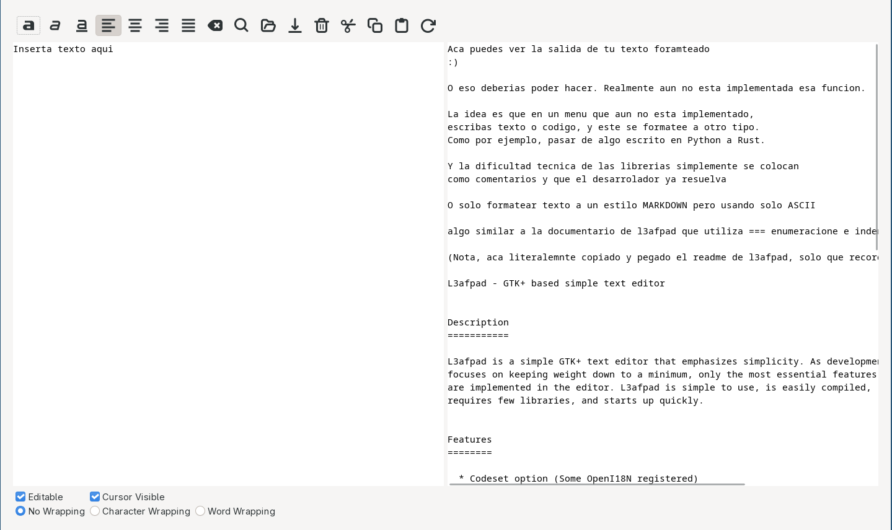

# Nota
Funciones
Por ahorita como puede guardar, editar y cargar.
EL resto de los botones no funcionan, son solo adorno (por ahora!)

# SOTE
Samerk Obvius Text Editor

# Desarrollo
Hecho en Python
con Gtk 3.0

# Licencia
Licencia MIT

has lo que quieras con esto comercial o no sin ningunra garantia y todo bajo tu propios riesgo y todo eso que sale en una licencia MIT...